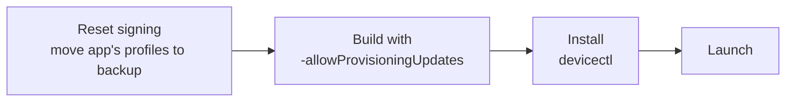

# AirRefresh

[](https://github.com/nikolaus018/airRefresh/actions/workflows/ci.yml)


[](LICENSE)

macOS menu-bar app that keeps up to three iOS apps signed and installed on an iPhone
under a free Apple ID, whose provisioning profiles expire after 7 days. Apps are
built from Xcode projects or re-signed from `.ipa` files, on demand or automatically
before the profile expires.



## Contents

- [Why](#why)
- [Features](#features)
- [Requirements](#requirements)
- [Install](#install)
- [Quick start](#quick-start)
- [How a refresh works](#how-a-refresh-works)
- [Automatic refresh](#automatic-refresh)
- [Using the app](#using-the-app)
- [Troubleshooting](#troubleshooting)
- [What AirRefresh touches on your Mac](#what-airrefresh-touches-on-your-mac)
- [Development](#development)
- [Contributing](#contributing)
- [License](#license)

## Why

Provisioning profiles issued to a free Apple ID **expire after 7 days**, after
which the app no longer launches. Renewing means:

1. removing the stale profiles,
2. rebuilding with `-allowProvisioningUpdates` so Xcode issues new ones,
3. reinstalling on the device.

AirRefresh runs this sequence from one button, or on a schedule before the
profile expires.

> **Intended for** developers installing their own apps on their own iPhone
> without a paid developer account. Paid accounts get year-long profiles and do
> not need this.

## Features

- **One-click refresh**: reset signing, rebuild, reinstall and relaunch in one go.
- **Xcode projects or `.ipa` files.** An `.ipa` is re-signed with a fresh free
  profile; nothing needs to be rebuilt.
- **Refreshes on its own** before a profile expires, when the iPhone is in
  reach and the Mac is idle.
- **Careful with your signing setup.** Only the profiles for the app being
  refreshed are touched, and they are moved to a backup folder, never deleted.
- **Three slots**, one per app, each with its own target iPhone (that's
  Apple's limit for free accounts).
- **Readable failures**: a banner says why a refresh failed, with a hint when
  the cause is a known one, and the full log is one click away.
- **Lives in the menu bar**, with optional start-at-login and notifications.

## Requirements

- macOS 14 or later
- Xcode 16 or later (developed with Xcode 26)
- Your Apple ID signed in under **Xcode ▸ Settings ▸ Accounts**
- For projects: a team picked under *Signing & Capabilities* in each project
- An iPhone that is paired with the Mac, unlocked, and has **Developer Mode** on

## Install

### Build from source (recommended)

```bash
git clone https://github.com/nikolaus018/airRefresh.git
cd airRefresh
open AirRefresh.xcodeproj    # then press ⌘R
```

To get a standalone app, run `./Scripts/build-release.sh`. It writes a zipped
`AirRefresh.app` into `dist/`. Move the app to `/Applications`: macOS will only
keep *Start at login* for an app that stays in one place.

### Download a release

When a [release](https://github.com/nikolaus018/airRefresh/releases) is
published, download `AirRefresh-<version>.zip`, unzip it and drag
`AirRefresh.app` to `/Applications`.

The app is not signed with a paid developer certificate, so macOS blocks it the
first time. Either right-click
the app ▸ **Open** ▸ **Open**, or run:

```bash
xattr -dr com.apple.quarantine /Applications/AirRefresh.app
```

### First launch

AirRefresh is **not sandboxed**, because it runs `xcodebuild`, `devicectl` and
`codesign` and reads `~/Library`. macOS will ask for access to the folders your
projects are in (Desktop, Documents, …). Allow it, or grant **Full Disk
Access** under System Settings ▸ Privacy & Security if your projects are spread
across many places.

## Quick start

1. Connect your iPhone once over USB, unlock it, and trust the Mac. After that
   it also works over Wi-Fi.
2. Open AirRefresh and press **Add Project…** (`⌘N`), or drag a project or
   `.ipa` onto the empty slot.
3. Check the card:
   - **Project:** pick the **Scheme**. It's filled in when there's an obvious one.
   - **`.ipa`:** pick the **Team**, and enter a **Bundle ID** of your own if the
     app isn't yours (see [below](#ipa-files)).
   - Pick the **iPhone**. With only one paired, it's already filled in.
4. Press **Refresh**. When it's done, the card shows how many days the new
   signature lasts.

From then on, AirRefresh refreshes that slot by itself before it expires.

## How a refresh works

### Xcode projects

1. **Reads the build settings** to learn which app is about to be built, so
   the next step only touches that app.
2. **Resets signing.** It moves the profiles for *this* app, plus any that have
   already expired, out of
   `~/Library/Developer/Xcode/UserData/Provisioning Profiles` (Xcode 16+) and
   `~/Library/MobileDevice/Provisioning Profiles` (older Xcode). Profiles of your
   other apps and other teams stay put.
3. **Cleans the build** *(optional)* by deleting AirRefresh's own build folder
   for that slot. Your Xcode DerivedData is never touched.
4. **Builds**
   ```
   xcrun xcodebuild -project <path> -scheme <scheme> -configuration Debug \
        -destination id=<device udid> -derivedDataPath <per-slot dir> \
        -allowProvisioningUpdates build
   ```
5. **Installs** it with `xcrun devicectl device install app --device <device> <app>`.
6. **Launches** it *(optional)* with `xcrun devicectl device process launch --terminate-existing <bundle id>`.

### `.ipa` files

An `.ipa` can't be rebuilt, and a free Apple ID only gets a new profile when
Xcode builds something. So AirRefresh builds something tiny:

1. **Unpacks** the `.ipa` into `~/Library/Application Support/AirRefresh/IPA/<slot>`.
2. **Resets signing** for the bundle ID it's about to sign, as above.
3. **Gets a profile.** It writes a one-file helper project with that bundle ID
   and your team, and builds it with `-allowProvisioningUpdates`. The helper is
   never installed; AirRefresh only takes the profile Xcode puts inside it.
4. **Re-signs** the app with that profile and the matching certificate from
   your keychain, frameworks first and then the app.
5. **Installs** and **launches** it, like a project slot.

An `.ipa` card has two fields where a project has its scheme:

- **Team**: filled in when this Mac knows only one (free) team. The list comes
  from Xcode ▸ Settings ▸ Accounts and from the profiles on disk.
- **Bundle ID**: leave it empty to keep the `.ipa`'s own ID. A free Apple ID
  can't use an ID another developer already registered, so for someone else's
  app enter your own, such as `com.yourname.appname`.

Limits that come with free accounts, not with AirRefresh:

- **App extensions and watch apps are removed.** Each would need its own
  profile, and a free account only gets 3 apps and 10 new bundle IDs a week.
- **Only basic entitlements are signed.** Apps that rely on app groups,
  iCloud or push notifications may not work properly.
- **`.ipa`s downloaded from the App Store are encrypted** and won't open after
  re-signing. AirRefresh warns when it spots one; use a decrypted build.

The first re-sign may make macOS ask whether `codesign` may use your signing
key. Choose **Always Allow**, or the 3am refresh will wait for you to click it.

### While it runs

Every command and all of its output go into the slot's log. **Stop** ends the
running command (`SIGTERM`, then `SIGKILL` if it doesn't quit). A run that
hasn't finished after 30 minutes gives up on its own, so one stuck build can't
block future automatic refreshes. Each step can be switched off under
**Advanced** on the card.

## Automatic refresh

AirRefresh reads the real expiry date from each installed profile. When an app
gets within the threshold (2 days by default), it waits for a good moment and
refreshes it:

- the iPhone has to be reachable,
- the Mac has to have been idle for a few minutes, so a refresh never competes
  with your own work,
- on the **last day** it stops waiting for idle time and just runs.

Safeguards:

- **An app is only refreshed automatically after you've refreshed it by hand
  once**, so automation is never the first thing to find a signing problem.
- **Failures back off**: two hours between retries, and after three failures in
  a row the app is left alone until you refresh it yourself. Pressing **Stop**
  never counts as a failure.
- **macOS App Nap is kept from pausing the scheduler** while automatic refresh
  is on. AirRefresh does *not* keep the Mac awake; a late refresh is better
  than a laptop that never sleeps.

**Settings ▸ Automatic** shows what the scheduler plans for each app, e.g.
"Healthy · refreshes itself in about 3 days" or "Due — waiting for the Mac to
be idle".

## Using the app

- **Add Project…** (`⌘N`) opens the file picker. Choose an `.xcodeproj`,
  `.xcworkspace` or `.ipa`, or the folder that contains one, or drag one onto
  an empty slot. **Change…** swaps what a slot points at.
- **Double-click a name** to rename a slot (or use `⋯ ▸ Rename`). Leave it
  empty to use the file's name.
- The **iPhone** menu lists every paired device from `xcrun devicectl list devices`.
  Each slot can target a different phone.
- **Refresh All** refreshes every set-up slot, one after another.
- **Closing the window doesn't quit the app.** Quit from the menu bar icon,
  which also shows overall health and has a submenu per app.
- **Settings ▸ General**: start at login, menu-bar only (no Dock icon), and
  notifications when an automatic refresh finishes.
- **`⋯ ▸ Open Profile Backups`** shows every profile AirRefresh has moved
  aside. Move them back if a reset ever makes things worse.

### Keyboard shortcuts

| Shortcut | Action |
|---|---|
| `⌘1` `⌘2` `⌘3` | Refresh slot 1 / 2 / 3 |
| `⌘R` | Refresh all |
| `⇧⌘R` | Reset signing only (asks first) |
| `⌘N` | Add a project or `.ipa` |
| `⌘.` | Stop everything |
| `⌘,` | Settings |

## Troubleshooting

When AirRefresh recognises an error, it shows a 💡 hint next to it. The common
ones:

| What you see | What to do |
|---|---|
| "maximum number of apps for free development profiles" | A free Apple ID allows 3 apps at a time. Delete an old dev build from the iPhone. |
| **Untrusted developer** on the iPhone | Settings ▸ General ▸ VPN & Device Management, then trust your certificate. |
| "Unable to find a device matching…" / device not found | Wake and unlock the iPhone, make sure it's on the same Wi-Fi, and click **Scan Again**. |
| `application-identifier` mismatch | This bundle ID was signed by a different certificate before. Delete the app from the iPhone and refresh again. |
| "requires a development team" | Open the project in Xcode once and pick your team under Signing & Capabilities. |
| "scheme is not currently configured" | The scheme isn't shared. Xcode ▸ Product ▸ Scheme ▸ Manage Schemes, tick **Shared**. |
| "cannot be registered to your development team" | Another developer owns that bundle ID. Enter your own in the `.ipa`'s **Bundle ID** field. |
| "maximum App ID limit" | Free accounts can register 10 new bundle IDs every 7 days. Wait, or reuse one you already have. |
| "No signing certificate … matches the new profile" | Xcode ▸ Settings ▸ Accounts ▸ Manage Certificates…, and make sure an Apple Development certificate is listed. |

If none of these fit, copy the log (**Log ▸ Copy Log**) and
[open an issue](https://github.com/nikolaus018/airRefresh/issues).

## What AirRefresh touches on your Mac

| Location | What happens there |
|---|---|
| `~/Library/Developer/Xcode/UserData/Provisioning Profiles`<br>`~/Library/MobileDevice/Provisioning Profiles` | Profiles for the app being refreshed, plus expired ones, are **moved** (never deleted) to the backup folder below. |
| `~/Library/Application Support/AirRefresh/ProfileBackups/` | Timestamped backups of every profile moved. |
| `~/Library/Application Support/AirRefresh/DerivedData/` | Per-slot build output, kept apart from Xcode's own. |
| `~/Library/Application Support/AirRefresh/IPA/` | Unpacked `.ipa`s and the helper project, rebuilt on every run. |
| Your projects and `.ipa` files | Read only; never changed. |

AirRefresh has no servers, analytics or network code of its own. The only
network traffic is what `xcodebuild` sends to Apple to get profiles, and what
`devicectl` sends to reach your iPhone.

## Development

```bash
xcodebuild test -project AirRefresh.xcodeproj -scheme AirRefresh -destination 'platform=macOS'
./Scripts/build-release.sh          # → dist/AirRefresh-<version>.zip
swift Tools/GenerateAppIcon.swift   # redraws the app icon
```

**126 tests, and none of them need a network connection, an Apple ID or an
iPhone.** They cover:

- which profiles a signing reset moves, and the moving itself (including
  putting everything back if it fails part-way),
- running processes: streamed output and stopping them,
- every rule the scheduler uses to decide when to refresh,
- reading `devicectl` output and profile expiry dates,
- loading slots saved by older versions,
- both pipelines from start to finish.

The pipelines run against a fake. `SlotRunner` reaches the outside world only
through `RunEnvironment`, a struct of closures for running processes, moving
profiles and touching files. The tests swap in a fake, run the real project and
`.ipa` sequences, and check exactly what each step asked for, down to the
`xcodebuild` and `codesign` arguments. Nothing is actually run or moved.

The project builds without warnings under `SWIFT_STRICT_CONCURRENCY = complete`.
CI ([`.github/workflows/ci.yml`](.github/workflows/ci.yml)) runs the tests, a
Release build and the icon generator on every push. Pushing a `v*` tag builds
the app and publishes it as a GitHub release.

### Project layout

| File | Role |
|---|---|
| `AirRefresh/Models.swift` | `ProjectSlot`, `Device`, `SyncPhase`, `LogLine` |
| `AirRefresh/Shell.swift` | Runs processes and streams their output |
| `AirRefresh/DeviceManager.swift` | Finds devices with `devicectl` |
| `AirRefresh/SigningReset.swift` | Decides which profiles get moved, and moves them |
| `AirRefresh/ProfileInspector.swift` | Reads name, team, expiry and certificates from profiles |
| `AirRefresh/SlotRunner.swift` | The project and `.ipa` pipelines |
| `AirRefresh/IPASigning.swift` | Helper project, re-signing, entitlements, finding teams |
| `AirRefresh/RunEnvironment.swift` | The interface between the pipelines and the outside world |
| `AirRefresh/Scheduler.swift` | Decides when an app refreshes itself |
| `AirRefresh/Preferences.swift` | Settings, login item, Dock and menu-bar behaviour |
| `AirRefresh/AppState.swift` | Slots, saving, schemes, teams, notifications |
| `AirRefresh/ContentView.swift` | Main window, header and device bar |
| `AirRefresh/SlotCardView.swift` | One slot's card |
| `AirRefresh/MenuBarView.swift` | Menu bar menu |
| `AirRefresh/SettingsView.swift` | Settings window |
| `AirRefresh/LogView.swift` | Log view that follows new output |
| `Tools/GenerateAppIcon.swift` | Draws the app icon in code |

### Before you change things

- **`ProjectSlot` decodes by hand.** Swift's built-in decoder fails when a key
  is missing, even if the property has a default. Adding a field without
  updating `init(from:)` would wipe everyone's saved slots on upgrade.
- **The scheduler's rules are a pure function**, `Scheduler.verdict(for:rules:)`.
  The caller collects everything from outside (device list, idle time, clock),
  which is what makes the rules testable.
- **Slots are looked up by ID, never by position.** SwiftUI can still render a
  card after its slot is removed, and an index would then crash.
- **A run takes over its `SlotRunner` immediately**, before its `Task` starts.
  A `Task` created on the main actor only starts after the current turn, so
  two quick clicks would otherwise both get through.
- **Every write from a run checks that the run is still current.** After Stop,
  the old task is still finishing; this keeps it from overwriting a run started
  right after.
- **A run ends as `.succeeded`, `.failed` or `.stopped`.** Counting Stop as a
  failure once triggered retry delays and paused healthy apps.

## Contributing

Bug reports and pull requests are welcome. Please:

- run the tests before opening a PR, and add one for any behaviour you change,
- keep the build warning-free under strict concurrency,
- add a line to [`CHANGELOG.md`](CHANGELOG.md) under an *Unreleased* heading.

## License

MIT, see [LICENSE](LICENSE).
