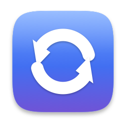

<div align="center">



# AirRefresh

**Your free-Apple-ID apps stop working after 7 days. This fixes that, on its own, before you notice.**

A menu-bar app for macOS that keeps up to three of your Xcode projects signed and
installed on your iPhone — with one button, or with no button at all.

</div>

---

## The problem

If you build iOS apps with a free Apple ID, every provisioning profile you get
expires after **7 days**. One morning the app you built for yourself just…
doesn't open. The fix never changes:

1. throw away the stale profiles,
2. rebuild with `-allowProvisioningUpdates` so Xcode mints new ones,
3. reinstall on the phone.

It takes two minutes and you have to remember to do it every single week, for
every app you keep on your phone.

AirRefresh is that routine behind one button — and it can run the routine for
you, at 3am, before the profile ever dies.

> **Who this is for:** anyone shipping side projects to their own phone without
> paying $99/year. If you have a paid developer account your profiles last a
> year and you do not need this.

## What a refresh actually does

1. **Reads the build settings** to find out which app is about to be built. This
   is what lets the next step be surgical.
2. **Resets signing** — moves the provisioning profiles that cover *this* app,
   plus any that have already expired, out of
   - `~/Library/Developer/Xcode/UserData/Provisioning Profiles` (Xcode 16+)
   - `~/Library/MobileDevice/Provisioning Profiles` (older Xcode)

   Profiles are **moved, never deleted**, into a timestamped folder under
   `~/Library/Application Support/AirRefresh/ProfileBackups/`. If a reset ever
   makes things worse, move them straight back — `⋯ ▸ Open Profile Backups`.

   Profiles belonging to your other projects, and to any other team, are left
   exactly where they are.
3. **Cleans the build** *(optional)* — removes AirRefresh's own build folder for
   that slot. Your Xcode DerivedData is never touched.
4. **Builds**
   ```
   xcrun xcodebuild -project <path> -scheme <scheme> -configuration Debug \
        -destination id=<device udid> -derivedDataPath <per-slot dir> \
        -allowProvisioningUpdates build
   ```
   `-allowProvisioningUpdates` is the flag that makes Xcode mint a fresh profile.
5. **Installs** — `xcrun devicectl device install app --device <device> <built .app>`
6. **Launches** *(optional)* — `xcrun devicectl device process launch --terminate-existing <bundle id>`

Every command and every line of its output is streamed into the per-slot log.
**Stop** kills the child process — `SIGTERM`, then `SIGKILL` if it is ignored —
so a hung `xcodebuild` never outlives the button. A run that has not finished in
30 minutes gives up on its own, so one wedged build cannot quietly block every
future automatic refresh.

All six steps sit behind the single **Refresh** button — there is no separate
"reset signing" step to remember. The individual switches are under **Advanced**
if you want to turn one off.

## Refreshing itself

AirRefresh reads the real `ExpirationDate` out of each installed profile, so it
knows exactly how long every project has left. Once a project drops under the
threshold (2 days by default) it waits for a good moment and refreshes on its own:

- the iPhone has to be reachable,
- the Mac has to have been idle for a few minutes, so it never fights you for
  the CPU in the middle of your own build,
- on the **last day** it stops waiting for a quiet moment and just runs.

Two deliberate limits keep it from misbehaving:

- **A project is never automated until you have refreshed it by hand once.**
  Automation should not be the thing that discovers your signing is misconfigured.
- **Failures back off** — two hours between retries, and after three consecutive
  failures the project is left alone until you refresh it yourself. Pressing
  **Stop** is not a failure and is never held against a project.

While automatic refresh is on, AirRefresh holds an activity assertion so macOS
does not put the app to sleep under App Nap and quietly skip the 3am run. It
does *not* keep the Mac awake — a missed refresh is a much better trade than a
laptop that never sleeps.

**Settings ▸ Automatic** shows, per project, exactly what the scheduler is
currently thinking — "Healthy · refreshes itself in about 3 days",
"Due — waiting for the Mac to be idle", and so on. The rules are a pure function
with a [test suite](AirRefreshTests/SchedulerRulesTests.swift) pinning every
branch of it down.

## Installing

AirRefresh is **not** signed with a paid Apple Developer certificate — which
would be a strange thing to require of an app whose whole purpose is not having
one. So macOS will not open it on the first try.

**Download** the latest `AirRefresh.zip` from Releases, unzip it, and drag
`AirRefresh.app` to `/Applications`. Then either:

- right-click the app ▸ **Open** ▸ **Open** (the one-time Gatekeeper detour), or
- clear the quarantine flag yourself:

  ```bash
  xattr -dr com.apple.quarantine /Applications/AirRefresh.app
  ```

**Or build it yourself**, which avoids all of that:

```bash
git clone <this repo>
cd AirRefresh
open AirRefresh.xcodeproj    # then ⌘R
```

Keeping the app in `/Applications` matters if you want *Start at login* to
stick — macOS refuses to register a login item that moves around.

### First run

The app is **not sandboxed**: it has to run `xcodebuild` and reach into
`~/Library`. macOS will ask for access to whichever folder your projects live in
(Desktop, Documents, …). Allow it, or grant **Full Disk Access** in
System Settings ▸ Privacy & Security if you keep projects in many places.

## Using it

- **Add Project…** (`⌘N`) opens the picker straight away. Pick an `.xcodeproj`
  or `.xcworkspace`, or the folder that holds one. You can also drag one from
  Finder onto an empty slot. **Change…** swaps the project on a slot you have
  already set up. Schemes are read from the project with `xcodebuild -list`.
- When a refresh fails, the card says why in a banner, with a 💡 hint when
  AirRefresh recognises the cause. The full log is one click away.
- Double-click a project's name to rename it (or `⋯ ▸ Rename`). Leave it empty
  and it falls back to the project file's own name.
- The **iPhone** dropdown lists every paired physical device from
  `xcrun devicectl list devices`. Each project targets its own device, so three
  projects can go to three different phones. With exactly one device paired it is
  filled in for you.
- **Refresh All** runs every configured project, one at a time.
- Slots and settings persist between launches.

Three projects is the ceiling because that is Apple's: a free Apple ID can sign
three apps at a time.

### Menu bar and login

The menu bar icon shows overall health and offers a submenu per project (*Refresh Now*, *Show in AirRefresh*), an
automatic-refresh toggle, and Quit without opening the window. **Closing the
window does not quit the app** — quit from the menu bar icon.

In **Settings ▸ General**:

- **Start AirRefresh at login** registers a login item via `SMAppService`. If
  macOS refuses, the settings pane tells you instead of failing silently.
- **Keep in the menu bar only** drops the Dock icon and app-switcher entry.
- **Notify me when an automatic refresh finishes** — only automatic runs notify;
  runs you started yourself are already on screen.

### Shortcuts

| | |
|---|---|
| `⌘1` `⌘2` `⌘3` | Refresh project 1 / 2 / 3 |
| `⌘R` | Refresh all |
| `⇧⌘R` | Reset signing only (asks first) |
| `⌘N` | Add a project |
| `⌘.` | Stop everything |
| `⌘,` | Settings |

## Requirements

- macOS 14 or later
- Xcode 16 or later (developed against Xcode 26.6 on macOS 26.6)
- Your Apple ID added in Xcode ▸ Settings ▸ Accounts, and a team selected in each
  project's Signing & Capabilities
- The iPhone paired, unlocked, and with Developer Mode enabled

## When it goes wrong

The log prints a 💡 hint when it recognises the cause. The usual ones:

| What you see | What it means |
|---|---|
| "maximum number of apps for free development profiles" | A free Apple ID allows 3 apps at a time. Delete an old dev build from the phone. |
| **Untrusted developer** on the phone | Settings ▸ General ▸ VPN & Device Management, then trust your certificate. |
| Device not found / "Unable to find a device matching" | Wake and unlock the phone, check it is on the same Wi-Fi, click *Scan Again* in the header. |
| `application-identifier` mismatch | The bundle ID was signed by a different certificate before. Delete the app from the phone and refresh again. |
| "requires a development team" | Open the project in Xcode once and pick your team under Signing & Capabilities. |
| "scheme is not currently configured" | The scheme is not shared. Xcode ▸ Product ▸ Scheme ▸ Manage Schemes ▸ tick *Shared*. |

## Development

```bash
xcodebuild test -project AirRefresh.xcodeproj -scheme AirRefresh -destination 'platform=macOS'
./Scripts/build-release.sh          # → dist/AirRefresh-<version>.zip
swift Tools/GenerateAppIcon.swift   # redraws the app icon
```

96 tests, no network and no device required. They cover the signing-reset rules
and the archiving itself, `Shell`'s streaming and cancellation against real
processes, the scheduler's whole decision table, `devicectl` parsing, profile
expiry lookup, and the slot migration path.

The pipeline itself is covered too. `SlotRunner` takes a `RunEnvironment` — a
struct of closures standing in for process spawning, profile archiving and the
filesystem — so `PipelineTests` drives the real inspect → reset → build →
install → launch sequence against a fake and checks what each step was actually
asked to do, including the exact `xcodebuild` argument list. Nothing is spawned,
nothing is moved, no device is needed.

The app icon is drawn in code rather than checked in as an opaque binary, so it
can be reviewed in a diff. CI checks that the generator still runs.

The whole target builds warning-free under `SWIFT_STRICT_CONCURRENCY = complete`,
which is on in both configurations. For an app that spends its life juggling
child processes, background tasks and a watchdog, that check earns its keep.

### Layout

| File | Role |
|---|---|
| `AirRefresh/Models.swift` | `ProjectSlot`, `Device`, `SyncPhase`, `LogLine` |
| `AirRefresh/Shell.swift` | Async process runner streaming merged stdout/stderr |
| `AirRefresh/DeviceManager.swift` | `devicectl` device discovery + JSON parsing |
| `AirRefresh/SigningReset.swift` | Which profiles get archived, and where they go |
| `AirRefresh/ProfileInspector.swift` | Reads name/team/expiry out of installed profiles |
| `AirRefresh/SlotRunner.swift` | The inspect → reset → build → install → launch pipeline |
| `AirRefresh/RunEnvironment.swift` | The seam the pipeline reaches the world through |
| `AirRefresh/Scheduler.swift` | Decides when a project refreshes itself |
| `AirRefresh/Preferences.swift` | Settings, login item, Dock/menu-bar policy |
| `AirRefresh/AppState.swift` | Slots, persistence, scheme discovery, notifications |
| `AirRefresh/ContentView.swift` | Window chrome, header, device bar |
| `AirRefresh/SlotCardView.swift` | One project slot |
| `AirRefresh/MenuBarView.swift` | The menu bar dropdown |
| `AirRefresh/SettingsView.swift` | Settings window |
| `AirRefresh/LogView.swift` | Auto-scrolling console |
| `Tools/GenerateAppIcon.swift` | Draws the app icon |

Three decisions worth knowing about before you change things:

- `ProjectSlot` has a **hand-written `init(from:)`**. Swift's synthesized decoder
  throws on a missing key even when the property has a default, so adding a
  field with the synthesized one would quietly wipe everybody's saved projects
  on upgrade.
- The scheduler's decision is a **pure function**,
  `Scheduler.verdict(for:rules:)`, taking a `Situation` struct. Anything that
  reaches out to the world — the device list, the idle timer, the clock — is
  gathered by the caller, which is what makes the rules testable.
- Slots are addressed **by id, never by array position**. SwiftUI will happily
  evaluate a card, or write through one of its bindings, after the slot behind
  it has been removed; an index-based binding turns that into a crash.
- A run **claims its `SlotRunner` synchronously**, before the `Task` that does
  the work is created. A `Task { }` made on the main actor does not start until
  the current turn ends, so a guard that only reads state the task sets is not
  a guard at all — two clicks in one turn both pass it.
- A run ends as one of three things, not two: `RunOutcome.succeeded`, `.failed`
  or `.stopped`. Folding Stop into "failed" is what made pressing it arm a
  backoff and eventually pause a healthy project.

## Licence

MIT — see [LICENSE](LICENSE).
